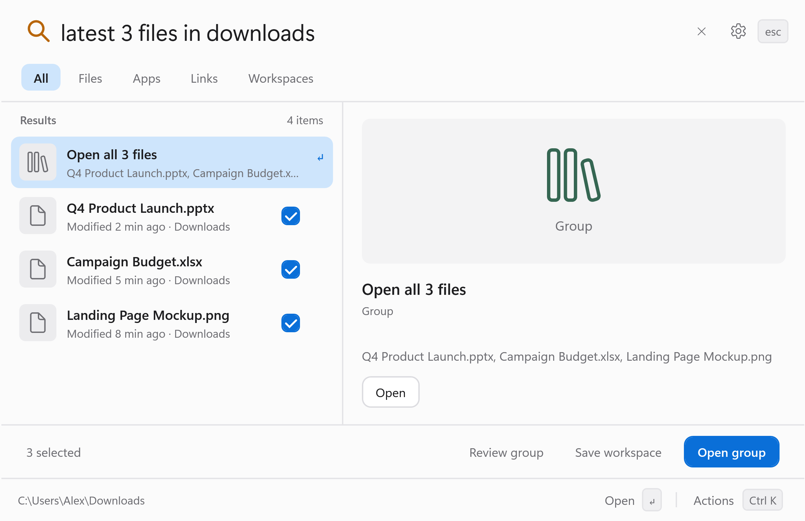

<h1 align="center">Scout</h1>

<p align="center">
  <strong>Find your work. Control your PC. Pick up where you left off.</strong>
</p>

<p align="center">
  A private launcher for Windows 11.<br>
  Search apps, files and browser history, preview results, and return to saved workspaces.
</p>

<p align="center">
  
  
  <a href="LICENSE"></a>
  
</p>

<p align="center">
  <a href="https://github.com/adilzubair/scout-site/releases"><strong>Download for Windows</strong></a>
  &nbsp;·&nbsp; <a href="https://scout.muhamedadil.com/">Website</a>
  &nbsp;·&nbsp; <a href="docs/USER_GUIDE.md">User guide</a>
  &nbsp;·&nbsp; <a href="docs/RELEASE_NOTES.md">Release notes</a>
</p>

<p align="center">
  <picture>
    <source media="(prefers-color-scheme: dark)" srcset="website/dist/scout-arrival-dark-3x.png">
    
  </picture>
</p>

<p align="center">
  <kbd>Ctrl</kbd> + <kbd>Space</kbd> to open. Type what you need. <kbd>Enter</kbd> to act.
</p>

> [!NOTE]
> This README describes **beta 3 development**. Public downloads are **beta 2**,
> which uses **Ctrl+Alt+Space** and does not include the multimodal add-on.
> Scout is experimental: accuracy and minimum hardware requirements are still
> being evaluated, the installer is unsigned, and updates are manual.

<p align="center">
  <a href="#what-you-can-do">Features</a> ·
  <a href="#local-ai-and-models">Models</a> ·
  <a href="#get-started">Get started</a> ·
  <a href="#keyboard-shortcuts">Shortcuts</a> ·
  <a href="#privacy-and-control">Privacy</a> ·
  <a href="#build-from-source">Build</a>
</p>

## What you can do

Describe what you need, or use a filename, app name or slash filter directly.
Local results appear first; optional AI can refine them.

| Capability | Try it |
|---|---|
| **Find apps, files and folders** | `notepad` · `budget excel` · `/folder projects` |
| **Search by time and activity** | `the pdf I just downloaded` · `latest 3 files in downloads` |
| **Narrow the results** | `/pdf roadmap` · `/image holiday` · `last pdf in "Project Files"` |
| **Revisit browser pages** | `docs links I visited today` — Chrome and Edge history are opt-in |
| **Control Windows** | `dark` · `wifi off` · `bluetooth on` · `volume up` · `lock screen` |
| **Calculate** | `15% of 240` · `sqrt(81)` |

- **Preview before opening.** Inspect PDFs, images, text, source files,
  Office/OpenDocument text, audio and video beside your results. Office previews
  show extracted text rather than the full application layout.
- **Open a group, then save it.** Review several results, open them together,
  and save the set as a workspace to recall later.
- **Search inside selected content.** Opt into local keyword indexing, or use
  the experimental EmbeddingGemma 2 add-on for multimodal content search.
- **Bring your own shortcuts.** Add `.lnk`/`.url` shortcuts and Power Automate
  desktop links, then find and run them by name.

Time filters use recorded evidence: created, modified, downloaded, opened and
visited each have their own timestamp source. Missing evidence cannot satisfy
the corresponding filter. [See how search evidence works.](docs/USER_GUIDE.md#search-evidence-and-privacy)

<details>
<summary><strong>See grouped results</strong></summary>

<p align="center">
  <picture>
    <source media="(prefers-color-scheme: dark)" srcset="website/dist/scout-download-group-dark-3x.png">
    
  </picture>
</p>

</details>

## Local AI and models

Scout's filename search, app search and supported system actions work without
downloading a model. Local AI is optional and off by default.

| Model | What it does in Scout | Availability |
|---|---|---|
| **[Laya](https://huggingface.co/convaiinnovations/laya)** | Decision models for candidate ranking, action intent, readiness and group membership. Available checkpoints: **English**, **multilingual** and **typed-decisions**. | Optional local AI. English is the recommended checkpoint in the current evaluation. |
| **[Google EmbeddingGemma 2](https://huggingface.co/google/embeddinggemma-2)** | Embeds text, images, audio and video for content retrieval. Indexes selected folders and returns matched evidence in previews. | Experimental **Settings → Multimodal** add-on in the current source; installed separately from Laya. |
| **[Qwen3-4B-Instruct-2507](https://huggingface.co/Qwen/Qwen3-4B-Instruct-2507)** | An experimental helper for descriptive file ranking, using a pinned Q4_K_M GGUF conversion through llama.cpp. | **Research-only**; hidden from standard Settings. [Evaluation and limitations.](docs/research/LOCAL_SEMANTIC_HELPER.md) |

Laya chooses among known candidates and supported actions; it never generates
shell commands. EmbeddingGemma 2 processes opted-in content in its separate
local worker. Document bodies are never sent to Laya or the Qwen helper.

### Set up local AI

1. Open **Settings**, choose **cpu** or **cuda** (NVIDIA GPUs), and click
   **Set up local AI**.
2. Enable local AI and save Settings. Start with the default **English**
   checkpoint.
3. For multimodal content search in the current source, configure the separate
   add-on under **Settings → Multimodal** and choose the folders to index.

Setup downloads isolated runtimes and pinned model weights, requiring several
GB plus cache space. It leaves system Python alone. Inference runs offline
after setup, and model weights are excluded from the application package.

Laya services are released after the launcher has been hidden for a minute.
CPU ranking can be slow and exceed its fallback budget on typical laptops;
local results remain available. See the [measured baseline](docs/research/LIGHTWEIGHT_BASELINE.md)
and [multimodal development status](docs/research/MULTIMODAL_ADDON.md).

<details>
<summary>Model pins and runtime details</summary>

- [Laya checkpoints and pinned revision](runtime/models.json)
- [EmbeddingGemma 2 revision and artifact checksums](runtime/embeddinggemma2_model.json)
- [Qwen GGUF and llama.cpp pins](runtime/semantic_model.json)
- [Third-party licenses and attributions](docs/THIRD_PARTY.md)
- [Local AI setup and behavior](docs/USER_GUIDE.md#local-ai)

</details>

## Get started

**Requires Windows 11 x64.**

1. Download **`Scout-Setup.exe`** from the
   [public beta releases](https://github.com/adilzubair/scout-site/releases)
   and run it. Setup installs for your account without admin rights.
2. Open Scout with **Ctrl+Alt+Space** in the published beta 2, or **Ctrl+Space**
   when running the current source.
3. Type an app name or a query, review the result, and press **Enter** to open it.

Prefer a portable copy? Extract the entire **`Scout-win-x64.zip`** archive and
run `Scout.exe`. SHA-256 checksum files accompany both downloads. Windows may
show a SmartScreen warning because the installer is unsigned.

Closing the panel keeps Scout in the notification area; **Ctrl+Q** quits.
To update, quit Scout and run the newer installer. To uninstall, use
**Uninstall Scout** from Start or **Settings → Apps**. Settings and workspaces
remain in `%LOCALAPPDATA%\Scout` for a later reinstall.

## Keyboard shortcuts

These shortcuts apply to the current source. The published beta 2 uses
**Ctrl+Alt+Space** to open the launcher.

| Shortcut | Action |
|---|---|
| <kbd>Ctrl</kbd> + <kbd>Space</kbd> | Open or hide Scout |
| <kbd>↑</kbd> / <kbd>↓</kbd> | Select a result |
| <kbd>Enter</kbd> | Run the selected action, open a group, or copy a calculation |
| <kbd>Tab</kbd> / <kbd>Shift</kbd> + <kbd>Tab</kbd> | Cycle All, Files, Apps, Links and Workspaces |
| <kbd>Ctrl</kbd> + <kbd>K</kbd> | Open result actions |
| <kbd>Ctrl</kbd> + <kbd>Alt</kbd> + <kbd>Space</kbd> | Preview a file |
| <kbd>Escape</kbd> | Close the current overlay, then the panel |

<details>
<summary>More shortcuts</summary>

| Shortcut | Action |
|---|---|
| <kbd>Ctrl</kbd> + <kbd>P</kbd> | Pin or unpin |
| <kbd>Ctrl</kbd> + <kbd>R</kbd> | Reveal in Explorer |
| <kbd>Ctrl</kbd> + <kbd>Shift</kbd> + <kbd>C</kbd> | Copy a path, URL or calculation |
| <kbd>Ctrl</kbd> + <kbd>Shift</kbd> + <kbd>Space</kbd> | Add or remove a group member |
| <kbd>Ctrl</kbd> + <kbd>,</kbd> | Open Settings |
| <kbd>Ctrl</kbd> + <kbd>Q</kbd> | Quit Scout |

</details>

## Privacy and control

- **Local search, no telemetry.** Your data stays in `%LOCALAPPDATA%\Scout`.
  Network access is limited to downloads for optional AI components and web
  searches or links you choose to open.
- **Choose what Scout can search.** Browser history, content indexing and AI
  are separately opt-in. Incognito data, cookies and open tabs are never read.
- **Keep document text out of ranking.** Laya receives query text, candidate
  titles and limited context such as recent app names and the clipboard's
  *kind*, never its contents. The separate embedding worker handles content
  only from folders you select.
- **You confirm every launch.** Nothing launches without **Enter** or an
  explicit **Open** action. Models select known candidate IDs and cannot
  create commands.
- **Control your index.** Turning keyword content search off clears its index.
  Folder restrictions and exclusions remain enforced during retrieval and
  model ranking.

Read the [user guide](docs/USER_GUIDE.md) for indexing rules, evidence sources,
folder restrictions and data controls.

## Build from source

You need Windows 11 x64 and the .NET SDK pinned in [`global.json`](global.json).
Python is needed only for optional AI; setup installs its own runtime. Building
the installer also requires [Inno Setup 7](https://jrsoftware.org/isinfo.php).

```powershell
git clone https://github.com/adilzubair/scout.git
cd scout
dotnet run --project src/Scout.App
```

Build, test and package:

```powershell
# Release build, native regression suite and packaging contract checks
powershell -NoProfile -ExecutionPolicy Bypass -File scripts/build.ps1

# Also produce a portable ZIP or a per-user installer
powershell -NoProfile -ExecutionPolicy Bypass -File scripts/build.ps1 -Publish
powershell -NoProfile -ExecutionPolicy Bypass -File scripts/build.ps1 -Installer
```

Outputs go to `artifacts/`. Diagnostic app modes must use a throwaway
`SCOUT_DATA_DIR` to keep your real profile untouched. See
[CONTRIBUTING.md](CONTRIBUTING.md) and the
[end-to-end test guide](tests/Scout.E2E/README.md).

<details>
<summary>Optional AI setup and Python checks</summary>

```powershell
# Omit -Cuda to use CPU
powershell -NoProfile -ExecutionPolicy Bypass -File scripts/setup-laya.ps1 -Cuda

.runtime/.venv/Scripts/python.exe runtime/test_runtime.py
.runtime/.venv/Scripts/python.exe runtime/test_http.py
```

</details>

<details>
<summary>Project layout</summary>

| Path | Contents |
|---|---|
| `src/Scout.Core` | Search engine, query parsing, ranking policy, indexing and SQLite storage |
| `src/Scout.App` | WPF launcher, settings, previews, Windows integration and model hosts |
| `runtime/` | Local AI sidecars, model manifests and the multimodal embedding worker |
| `tests/Scout.Tests` | Native regression checks |
| `tests/Scout.E2E` | Windows end-to-end runner |
| `scripts/` | Build, packaging, setup and evaluation tooling |
| `installer/` | Inno Setup installer |
| `evaluation/` | Frozen evaluation protocols |
| `docs/` | User, contributor and research documentation |
| `website/` | Static project website |

</details>

## Explore the docs

| Start here | Go deeper |
|---|---|
| [User guide](docs/USER_GUIDE.md) — settings, search and actions | [Interface](docs/UI.md) — visual system and UI checks |
| [Release notes](docs/RELEASE_NOTES.md) — published and upcoming changes | [Research notes](docs/research/README.md) — evaluations and model experiments |
| [Installer guide](docs/INSTALLER.md) — packaging and verification | [Tooling index](scripts/README.md) — development scripts |
| [Contributing](CONTRIBUTING.md) — build, test and PR guidance | [Third-party components](docs/THIRD_PARTY.md) — licenses and attributions |
| [Security policy](SECURITY.md) — report a security issue | [Behavior parity](docs/PARITY.md) — mapping Intern's behavior to Windows |

## Contributing

Bug reports, ideas and pull requests are welcome. Read
[CONTRIBUTING.md](CONTRIBUTING.md) before making changes, and use the
[security policy](SECURITY.md) to report security issues.

## Acknowledgements

Scout's behavior is modeled on [Intern](https://github.com/dabit3/intern), a
macOS launcher. Scout is an independent C#/WPF implementation and contains no
Intern code or assets. The split search panel is inspired by
[DigUp](https://github.com/ARahim3/DigUp), and the compact index borrows ideas
from [fsearch](https://github.com/noahdunnagan/fsearch). See
[third-party components](docs/THIRD_PARTY.md) for full attributions.

## License

[MIT](LICENSE) © Muhamed Adil. Optional models and dependencies retain their
respective upstream licenses.
